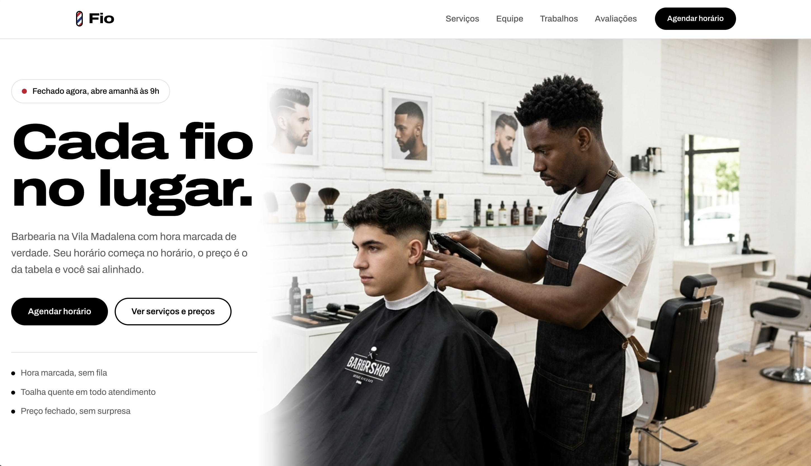

# 💈 Fio Barbearia

Site de uma barbearia fictícia, feito do zero com **HTML, CSS e JavaScript puros**: sem frameworks, sem dependências e sem etapa de build.

🔗 **Demo:** https://SEU-USUARIO.github.io/NOME-DO-REPOSITORIO/



> ⚠️ **Projeto demonstrativo.** Endereço, telefone, Instagram, preços, avaliações e barbeiros são inventados. O agendamento é **simulado**: a disponibilidade dos horários é gerada por uma função (não existe agenda real) e nenhum dado é enviado a lugar nenhum. As fotos são ilustrativas.

## Sobre o projeto

"Fio" tem dois sentidos: o fio de cabelo e o fio da navalha. A assinatura é **"Cada fio no lugar."**, e a proposta da barbearia é simples: hora marcada de verdade, preço fechado e toalha quente em todo atendimento.

O visual usa **branco como cor principal e preto como secundária**. O vermelho e o azul aparecem só no ícone do logo, uma referência ao poste de barbeiro. Os títulos usam Archivo em largura expandida.

## Funcionalidades

- **Página única** com cabeçalho fixo e botão de agendar sempre à vista
- **Status "Aberto agora / Fechado agora"**, calculado pela hora de quem visita e atualizado a cada minuto; o dia de hoje fica destacado na tabela de horários
- **Agendamento simulado:** serviço, barbeiro, data (próximos 30 dias) e horário, com confirmação na tela
- **Horários de 30 em 30 minutos** gerados a partir da grade de funcionamento; horários passados (ou com menos de 30 minutos de antecedência) ficam bloqueados
- **Próximo horário livre** de cada barbeiro, calculado na hora
- Botões "Agendar" nos serviços e na equipe que **já preenchem o formulário**
- **Validação do formulário** (nome e telefone com DDD), com mensagens de erro e foco no primeiro campo com problema
- **Galeria com foto ampliada** em modal (`<dialog>`): abre por mouse, toque ou teclado e fecha com `Esc` ou clicando fora da foto
- **Menu mobile animado** e link ativo conforme a seção visível (`IntersectionObserver`)
- **Layout responsivo:** abaixo de 1280px o hero empilha, com o texto em cima e a foto inteira embaixo
- **Acessibilidade:** link "pular para o conteúdo", opções de serviço, barbeiro e horário navegáveis por teclado, `aria-label` nos botões de ícone, foco visível e respeito a `prefers-reduced-motion`
- **SEO básico:** meta description, Open Graph, dados estruturados `schema.org/BarberShop` e favicon em SVG

## Destaques técnicos

- **Datas no fuso local:** a chave de data é montada com `getFullYear()`, `getMonth()` e `getDate()` em vez de `toISOString()`, que usa UTC e pode errar o dia perto da meia-noite
- **Disponibilidade simulada, mas estável:** a ocupação de cada horário vem de um hash (FNV-1a) de data, barbeiro e horário, então o mesmo horário dá sempre o mesmo resultado, sem aleatoriedade a cada visita
- **Hero sem caixa:** o degradê branco fica numa camada (`.hero::before`) que é sólida sob o texto e some antes do cliente na foto, sem contorno nem `backdrop-filter`
- **JavaScript em blocos:** variáveis, funções, rodar funções e código, com a parte de código separada por responsabilidade

## Tecnologias

- HTML5 semântico
- CSS3 com variáveis (custom properties), Grid, Flexbox, `aspect-ratio`, `@starting-style` e `@keyframes`
- JavaScript (ES6+), com `const`/`let` e `"use strict"`
- Google Fonts (Archivo, fonte variável) e embed do Google Maps

## Estrutura

```
.
├── index.html
├── styles.css
├── script.js
└── Imagens/
    ├── Imagem-hero.jpg
    ├── Barbeiros/
    └── Cabelos/
```

## Como rodar localmente

Não precisa instalar nada:

```bash
git clone https://github.com/SEU-USUARIO/NOME-DO-REPOSITORIO.git
cd NOME-DO-REPOSITORIO
```

Abra o `index.html` no navegador. Se preferir um servidor local, a extensão **Live Server** do VS Code funciona bem.

> O mapa e a fonte dependem de internet. A animação de entrada do modal usa `@starting-style`: em navegadores antigos ele abre normalmente, só sem animação.

## Próximos passos

- [ ] Conectar o agendamento a um back-end (por exemplo, FastAPI + PostgreSQL) com agenda real
- [ ] Bloquear os horários conforme a duração de cada serviço (hoje o combo de 75 min ocupa um horário só)
- [ ] Redimensionar e converter as fotos para WebP
- [ ] Adicionar imagem de pré-visualização (`og:image`) para o compartilhamento do link
- [ ] Revisar o contraste de cor dos textos secundários (WCAG)

## Autor

Feito por **Magoozim**.
